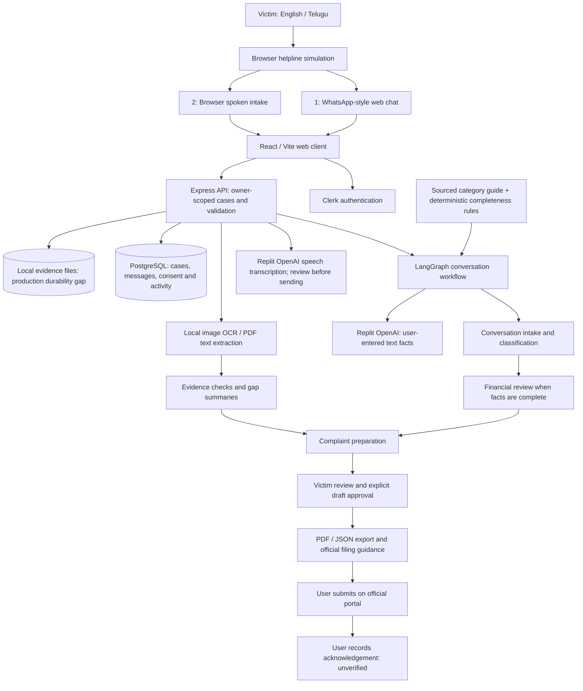
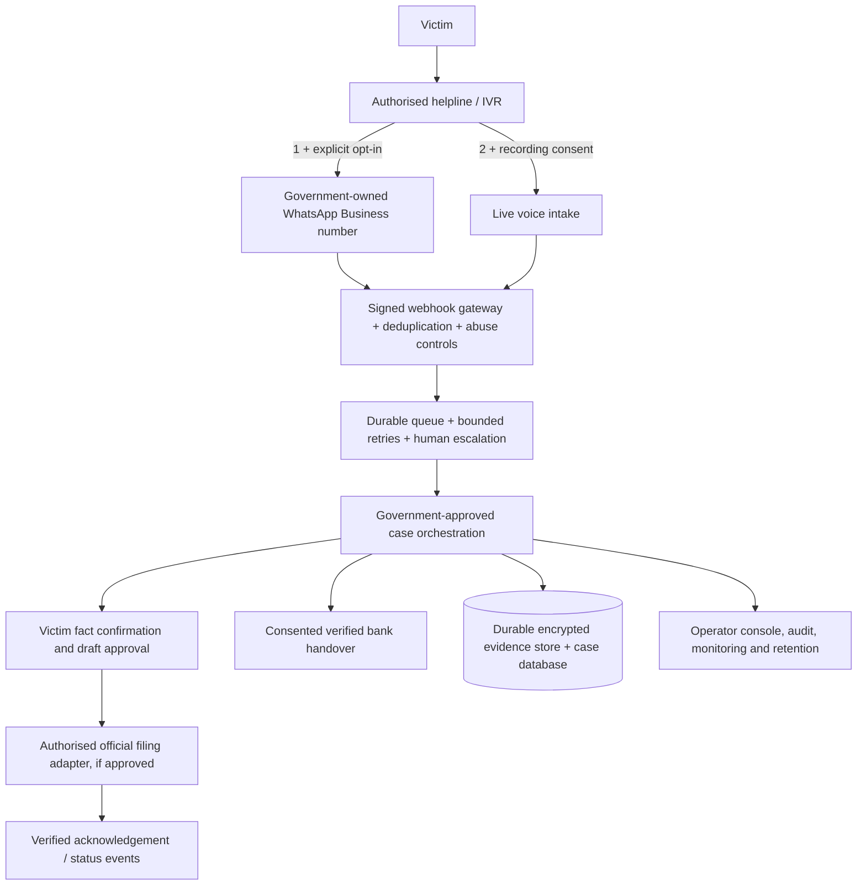

# Fraud Sahayak — Architecture

## Scope and status

This document separates the **implemented prototype** from the **proposed government-operated service**. The supplied architecture image is a target concept, not evidence of live government connectivity. The orchestrator uses LangGraph from the LangChain ecosystem. The primary case model is accessed through Replit OpenAI integration; the historical filename `gemini-agent.ts` does not identify the active provider.

[View the standalone architecture diagram](architecture.svg).

## Implemented architecture

The six responsibilities in the concept image are conversation, classification, financial analysis, evidence checks, complaint writing and reporting/tracking. They are **not six independent always-running workers**. The current graph coordinates conversation, classification and financial review; evidence, drafting and reporting also run through API-driven helpers. Deterministic gates, templates and local extraction complement model-assisted steps.

## Trust and data boundaries

| Data | Current processing | Boundary |
|---|---|---|
| Typed incident facts | API, database, model-assisted intake/review | Best-effort secret redaction; never ask for OTP/PIN/CVV/passwords |
| Short voice recordings | OpenAI transcription | External processing; user reviews transcript before sending |
| Images, PDFs and extracted OCR text | Local service extraction | Do not send evidence bytes or OCR text to external models |
| Evidence file bytes | Server filesystem | Not durable enough for an autoscaling production evidence store |
| Drafts and approval | Application and database | Approval is not government submission |
| Ticket / bank packet | Application simulation | No proof of SMS delivery or bank receipt |
| Official acknowledgement | Entered by user | Unverified unless a future authorised connector verifies it |

## Proposed government deployment

**All components in this second diagram are a target deployment design, not a claim of delivery.** Provider contracts, government authorisation, approved models/hosting, lawful processing and API access must precede integration. Do not automate portal OTP/captcha or claim an official reference from a local ticket.

## Deployment considerations

- Existing services: API at `/api`, web application at `/`, illustrative video at `/fraud-sahayak-walkthrough/`.
- PostgreSQL holds structured state. Do not depend on process memory for cross-instance case continuity.
- Move production evidence to an approved durable store before real-world rollout; preserve the local-extraction privacy boundary.
- Add durable delivery jobs, idempotency keys and verified provider receipts for real messaging.
- Government tenancy, operator roles, disaster recovery, retention enforcement, comprehensive immutable audit and load validation require further implementation.
- Consult [installation](installation-guide.md), [feature status](features.md), and [business requirements](business-requirements.md) before procurement or launch.
